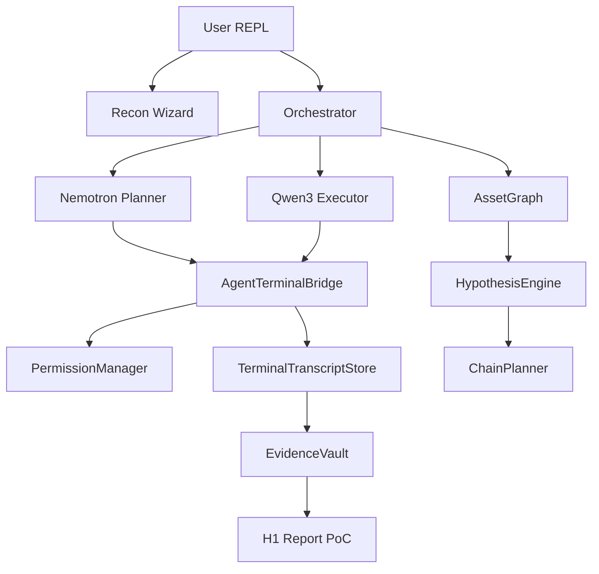

# WTH-AI v1.0 — Realtime Bug Hunter

WTH-AI adalah CLI bug bounty expert yang menggabungkan **multi-provider LLM**, **terminal akses terkontrol permission**, **asset graph**, **Discord/Telegram bot**, dan **anti-halusinasi berbasis bukti (TTST)**.

> Hanya untuk **authorized testing**: milik sendiri, lab, CTF, atau bug bounty in-scope.
> **v1.0** — first public release. Semua eksekusi real-time, tanpa simulasi.

---

## Apa yang Membuat WTH-AI Berbeda

| Fitur | Scanner biasa | WTH-AI v1.0 |
|-------|---------------|-------------|
| Otak | Prompt panjang | Graph + rule engine + LLM refine |
| Eksekusi | Satu tool | Planner/Executor **langsung curl & shell** via Agent Terminal |
| Klaim vuln | Sering halusinasi | **TTST**: wajib `[TX:...]` transcript bukti |
| Setup | Manual config | **Setup wizard** pertama kali (seperti OpenClaw) |
| Model | Satu provider | OpenRouter + Ollama + OpenAI/Anthropic/Google |
| Bot | Tidak ada | Discord & Telegram daemon |

---

## Arsitektur



**TTST (Terminal Transcript Source of Truth):** Setiap klaim kerentanan harus punya output terminal/HTTP nyata yang tersimpan sebagai `TX-{id}`.

Konstitusi lengkap: lihat [`AGENT.md`](AGENT.md).

---

## Instalasi (tanpa source code)

### Publik — npm + binary

```bash
npm install -g @wth-ai/cli
wth                    # download binary + setup wizard otomatis
wth-ai setup           # re-run wizard
```

Binary disimpan di `~/.wth-ai/runtime/`. Source code tidak diperlukan.

### Developer — dari source

```bash
git clone <private-repo> wth-ai && cd wth-ai
pip install --break-system-packages --user -e .
./install.sh
wth-ai setup
```

### Setup Wizard (first-run)

Wizard meminta:
1. Provider LLM (OpenRouter / Ollama / OpenAI / Anthropic / Google)
2. API key (validasi ping live)
3. Model per role: planner, executor, verifier
4. Permission default
5. Opsional: Discord & Telegram bot tokens

Config tersimpan di `~/.wth-ai/config/user.yaml` dan `~/.wth-ai/.env`.

### Jalankan

```bash
wth-ai                  # REPL interaktif
wth-ai run "/doctor"    # one-shot command
wth-ai bot discord      # Discord daemon
wth-ai bot telegram     # Telegram daemon
```

---

## Permission Modes

| Mode | Command | Terminal access |
|------|---------|-----------------|
| `read_only` | `/permission read_only` | curl, httpx, HEAD/GET, static tools |
| `standard` | `/permission standard` | + nuclei, ffuf, arjun, **run_shell** testing |
| `elevated` | `/permission elevated` | + sqlmap, dalfox (butuh `/approve`) |
| `full_lab` | `/permission full_lab` | Lab/CTF only — tetap ada denylist |

Agent **tidak bisa bypass** permission — semua command lewat `PermissionManager.check_command()`.

---

## Quick Start (5 menit)

```bash
wth-ai
/permission standard
/scope set target=app.example.com authorized=yes accounts=alice@x.com:pass1,bob@x.com:pass2
/recon
# → target › app.example.com
# → authorized › yes
/graph
/plan
/execute --all
/verify
/report
```

---

## Workflow Lengkap — Contoh Real-Time

### 1. Set Scope + Multi-Account

```bash
/scope set target=app.target.com authorized=yes accounts=userA@test.com:Secret1,userB@test.com:Secret2
/scope
```

Output menampilkan target, authorization, dan test accounts.

### 2. Recon Interaktif (Wizard)

```bash
/recon
```

Tanpa argumen:
1. Prompt berubah ke `target ›`
2. Ketik domain: `app.target.com`
3. Jika belum authorized → `authorized › yes`
4. Full recon 12 fase + live agent http_probe
5. Asset graph terisi otomatis

Contoh output:
```
## Recon — app.target.com
- Graph nodes: 47
- Graph coverage: 0%
- Parameters: 23
- API endpoints: 8
```

### 3. Lihat Asset Graph

```bash
/graph
```

Menampilkan nodes, edges, top params (`id`, `user_id`, `redirect`, dll).

### 4. Plan — Hypothesis + Chains

```bash
/plan Audit IDOR and SSRF on API endpoints
```

Planner:
1. Rule engine generate pre-hypotheses dari graph
2. LLM refine (JSON structured)
3. **Probe phase:** planner `http_probe` top URLs → `[TX:...]` citations
4. Chain planner buat exploit steps

### 5. Execute — Testing Langsung

```bash
/execute --all
```

Executor (Qwen3 Coder) via **Agent Tool Loop**:
- `run_shell` → `httpx`, `curl`, `nuclei` (sesuai permission)
- `http_probe` → request/response langsung
- Output disimpan sebagai `[TX:abc123]`

Untuk IDOR task (`evidence_schema.type: idor`):
- Butuh 2 accounts di scope
- Baseline userA → fetch as userB → diff response

### 6. Verify — 7-Question Gate

```bash
/verify
```

Verifier + Grounding Firewall:
- Tolak klaim tanpa `[TX:...]` atau evidence vault
- Schema gate: proof type harus match

### 7. Report H1-Ready

```bash
/report
```

Report include PoC blocks:

```http
GET https://app.target.com/api/orders/123
```

**Response:** `200` + body snippet (redacted).

---

## Hunt Otomatis (Graph-Driven)

```bash
/hunt "Comprehensive vuln hunt on API and auth flows"
```

Loop: recon → graph → hypotheses → plan → execute → verify → replan (max 5 iterasi).

Status bar menampilkan: `hyp 12 · chains 3 · cov 15% · verified 1`

---

## Perintah Utama

| Command | Fungsi |
|---------|--------|
| `/recon` | Wizard domain atau recon langsung |
| `/graph` | Ringkasan asset graph |
| `/plan` | Hypotheses + exploit chains |
| `/execute [--all]` | Jalankan tasks via terminal bridge |
| `/hunt` | Full automated loop |
| `/verify` | Validasi bukti |
| `/report` | Laporan H1 dengan PoC |
| `/permission` | Set mode testing |
| `/scope set accounts=...` | Multi-account untuk IDOR |

---

## Anti-Halusinasi (TTST)

1. **AGENT.md** — konstitusi wajib untuk semua agent
2. **GroundingFirewall** — klaim VERIFIED/FOUND tanpa `[TX:...]` diubah jadi `HIPOTESIS (belum dibuktikan)`
3. **Evidence Vault** — request/response pairs per finding
4. **Hypothesis Engine** — rules dari graph *sebelum* LLM mikir

---

## Troubleshooting

| Masalah | Solusi |
|---------|--------|
| LLM offline | Set `OPENROUTER_API_KEY` |
| Recon blocked | `/scope set authorized=yes` |
| IDOR blocked | Tambah `accounts=userA:pass,userB:pass` |
| Command blocked | `/permission standard` atau lebih tinggi |
| Tool missing | `/doctor` lalu `/tools install all` |
| pip PEP 668 | `pip install --break-system-packages --user -e .` |

---

## Keamanan & Etika

- Jangan test target tanpa izin tertulis
- Rate limit default: 2 req/s (ubah di scope)
- High-risk commands butuh `/approve`
- Secrets di-redact otomatis di transcript & report

---

## Struktur Proyek

```
wth_ai/
  terminal/     # AgentTerminalBridge + transcripts (TTST)
  graph/        # Asset graph
  brain/        # Hypothesis + chain planner
  agents/       # Planner, executor, tool loop, grounding
  executor/vuln/# IDOR, SSRF, XSS, auth, race
  recon/deep/   # JS, OpenAPI, GraphQL analysis
  evidence/     # Evidence vault
AGENT.md        # Konstitusi bug hunter
config/         # wth_config.yaml
```

---

## Versi

**v1.0.0** — First public release: realtime execution, setup wizard, multi-provider LLM, Discord/Telegram bots
