# Flows — Target Architecture (12 Diagram)

## 1. CLI Request Flow

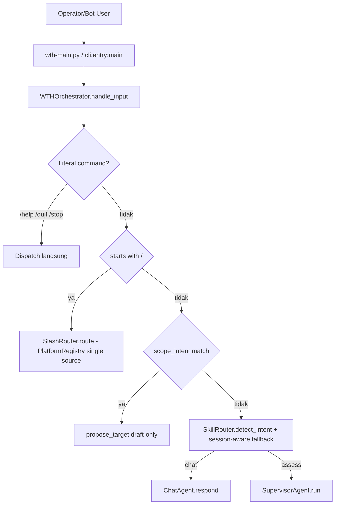

## 2. General Chat Flow

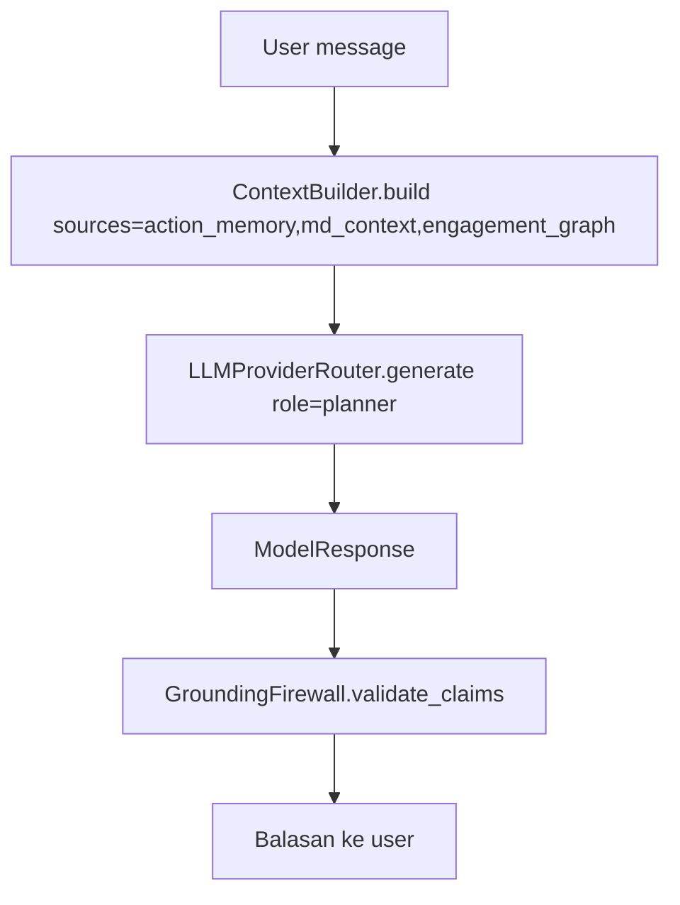

## 3. Recon Flow

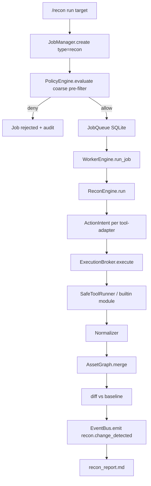

## 4. Autonomous Hunting Loop (/hunt)

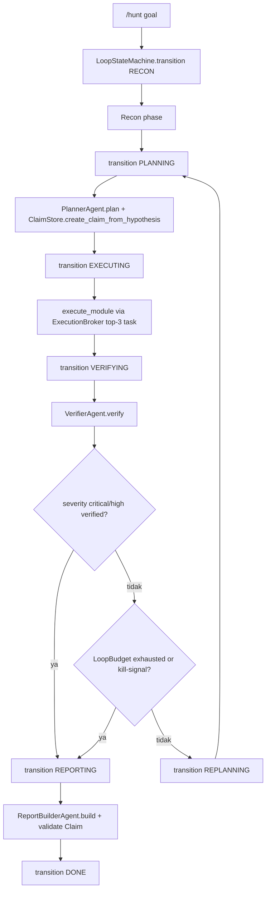

## 5. Permission Flow

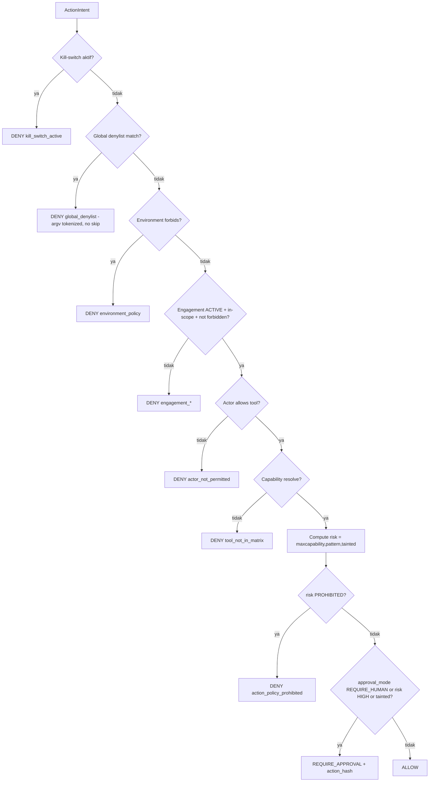

## 6. Approval Flow

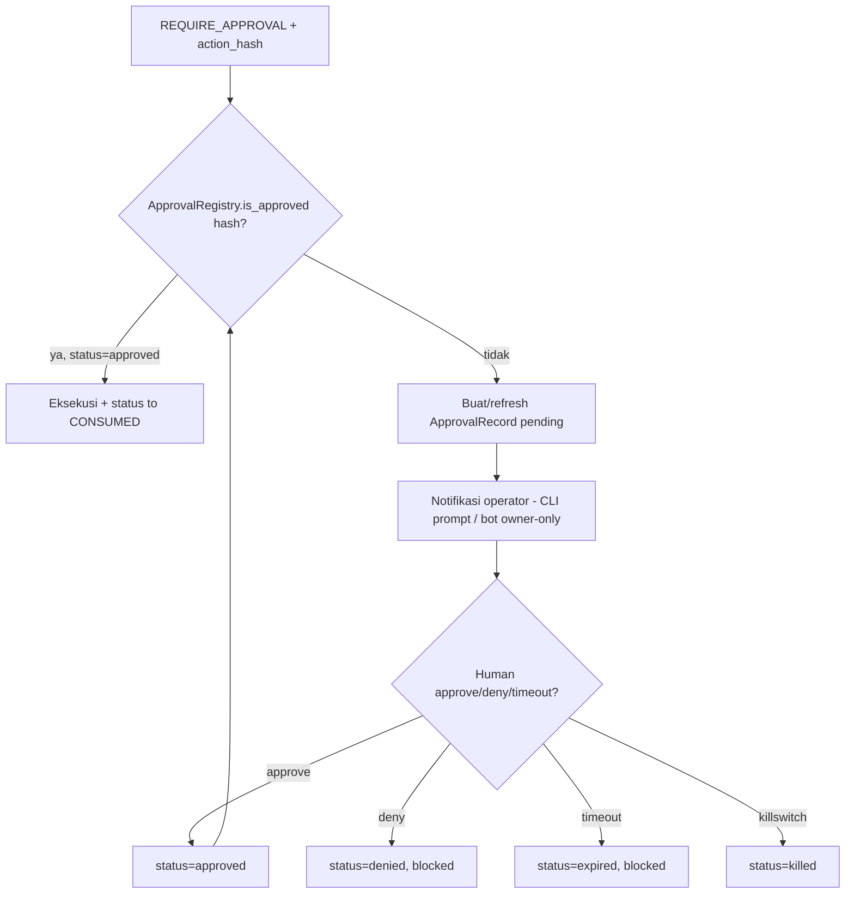

## 7. Tool Execution Flow

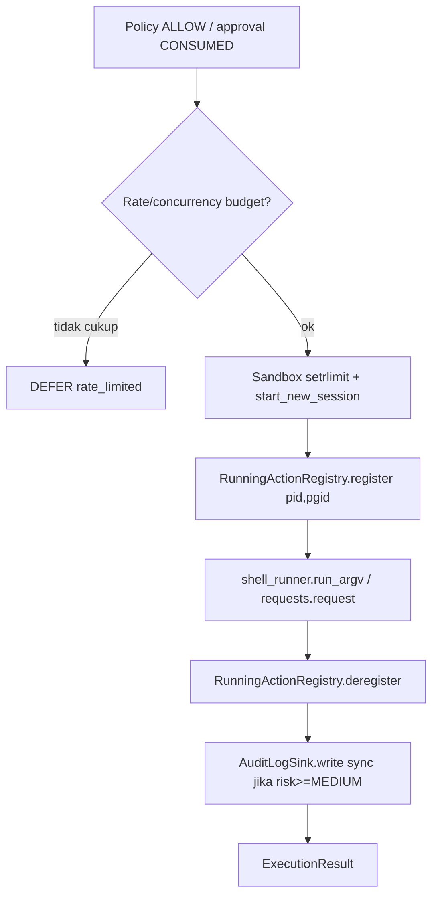

## 8. Evidence Flow

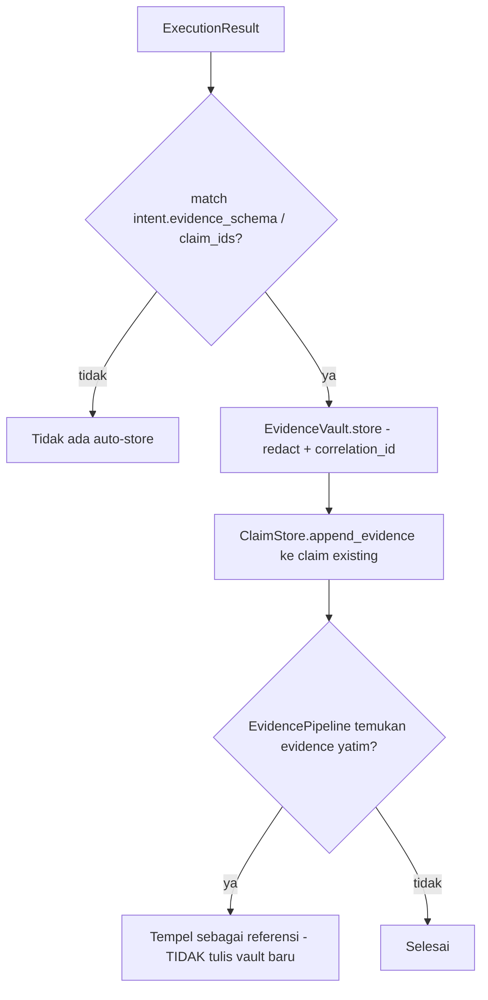

## 9. Finding Validation Flow

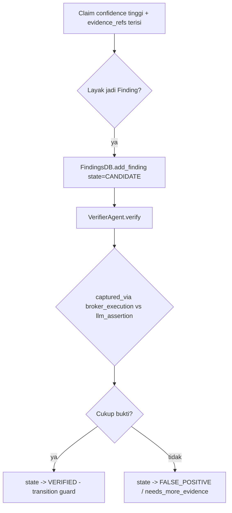

## 10. Model Routing Flow (role-based, TANPA auto-routing — ADR-006)

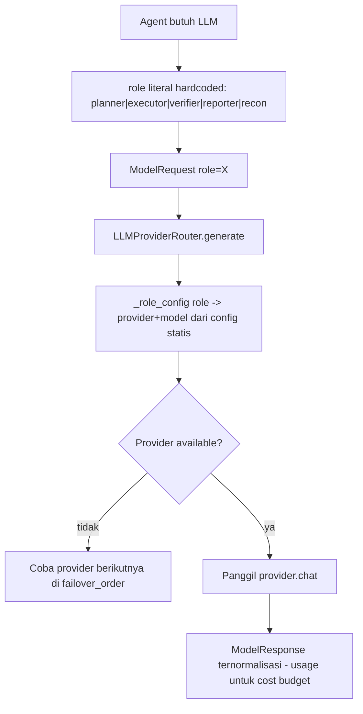

## 11. Checkpoint/Resume Flow

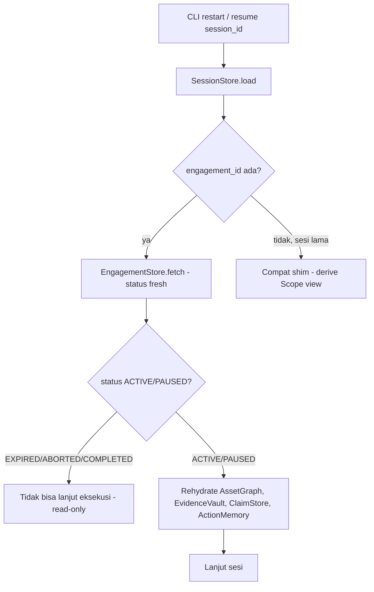

## 12. Failure/Retry Flow

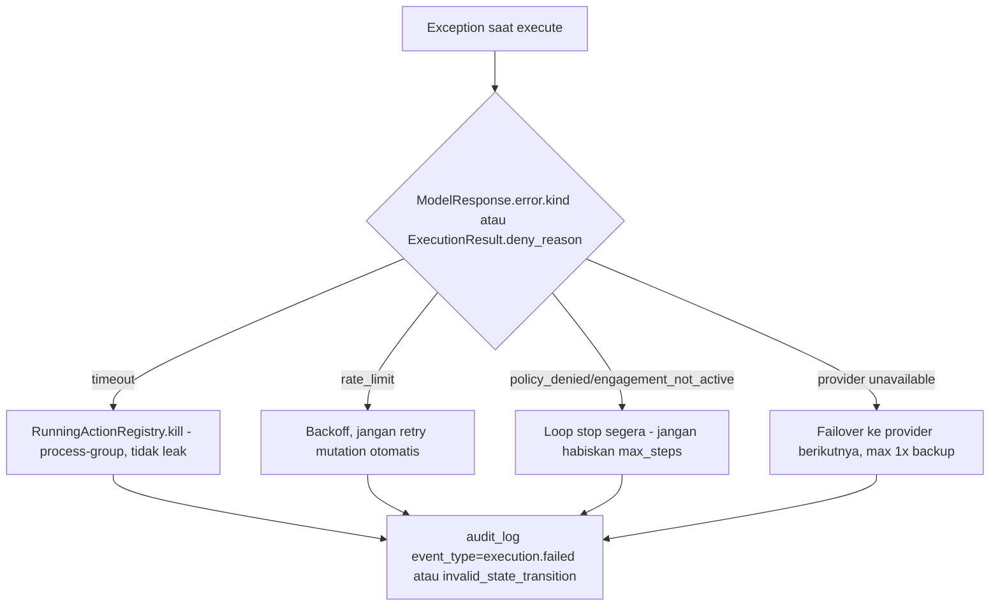
